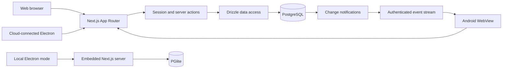

# LifeOS

**A personal planning system that connects long-term goals to today's work and shows what actually happened.**

LifeOS brings projects, habits, scheduled work, and reflection into one workflow: set a direction, plan the week, act today, then review recorded progress. It is a full-stack Next.js application with account-scoped PostgreSQL data, an Electron desktop package, and an Android WebView package.

[Open LifeOS](https://lifeos-gayashan-2026.vercel.app) · [Explore the code](https://github.com/gayashan-indrasankha/LifeOS) · [Run locally](#run-locally)


## Product at a glance

Productivity tools often separate outcomes from the routines and scheduled work meant to achieve them. LifeOS links goals and projects to tasks and time blocks, keeps habit check-ins alongside the daily plan, and uses weekly reviews to compare intentions with recorded activity. The loop is **Goals → Week → Today → Tracking → Review → next plan**.

| Area                 | What you can do                                                                                                                                                    |
| -------------------- | ------------------------------------------------------------------------------------------------------------------------------------------------------------------ |
| Goals and projects   | Organize goals, projects, tasks, academic subjects, and milestones; record practice and other evidence against real outcomes.                                      |
| Today and Week       | Assign up to three daily task priorities, choose a day mode, schedule recurring or one-off sessions, and move or skip individual flexible occurrences.             |
| Habits               | Track fixed-day routines or flexible weekly quotas. Historical check-ins remain tied to the schedule that applied on their date.                                   |
| Review and analytics | See habit adherence, completed tasks and sessions, recorded measurements, and a saved weekly reflection. The monthly dashboard retains the original habit tracker. |
| Personal setup       | Preview a selectable LifeOS starter plan and install missing items explicitly, while preserving customized or previously removed items.                            |
| Data portability     | Export a versioned JSON backup, merge nonconflicting records, or deliberately restore a backup for the signed-in account.                                          |

### Product preview

The repository contains the LifeOS logo but no committed screenshots of the application. To add an authentic preview, capture the **Today**, **Week**, **Goals**, **Review**, and narrow-screen dashboard views using a dedicated account with safe sample data. Remove names, notes, and other private information before committing images. Until then, the [hosted app](https://lifeos-gayashan-2026.vercel.app) can be explored by creating an account; no public demo account is supplied.

## Engineering behind the workflow

| Challenge                                          | Approach in the code                                                                                                                                                                                                                         | Why it matters                                                              |
| -------------------------------------------------- | -------------------------------------------------------------------------------------------------------------------------------------------------------------------------------------------------------------------------------------------- | --------------------------------------------------------------------------- |
| Editing a recurring plan without rewriting history | [Time-block rules](lib/planning/time-blocks.ts) and [habit schedule revisions](lib/analytics/habit-month-progress.ts) choose the latest rule effective on each occurrence date. Per-date exceptions retain the original occurrence identity. | A future change does not silently alter earlier plans or recorded checks.   |
| Preventing conflicting schedule writes             | [Schedule actions](lib/actions/life-actions.ts) validate ownership and overlaps, then recheck and write under a per-user PostgreSQL transaction advisory lock. Fixed commitments cannot be overridden by a flexible overlap.                 | Concurrent edits from different tabs are serialized at the point of saving. |
| Keeping daily priorities consistent                | [Priority actions](lib/actions/life-actions.ts) reorder tasks in a transaction; a [database unique index](lib/db/schema.ts) prevents duplicate priority slots for one user and date.                                                         | The Today plan cannot persist two tasks in the same slot.                   |
| Making starter setup repeatable                    | [LifeOS installation](lib/life-os/install.ts) previews changes and installs selected records transactionally. Stable template keys and [seed-item records](lib/db/schema.ts) avoid duplicating or recreating deleted starter items.          | Users can refine their setup without losing their own edits.                |

Account boundaries are enforced in server logic: [Better Auth](lib/auth/server.ts) supplies the session, [protected routes](proxy.ts) redirect unauthenticated visitors, and server actions query user-owned rows using the authenticated user ID. [Zod schemas](lib/validations/) validate form data, while composite owner foreign keys in the [Drizzle schema](lib/db/schema.ts) reinforce ownership relationships.

## Architecture and stack



The hosted service uses PostgreSQL, with Vercel and Neon deployment configuration documented in [DEPLOYMENT.md](DEPLOYMENT.md). Cloud-connected Windows and Android packages open the same hosted account. When built without a cloud URL, the packages retain separate local PGlite storage; local data does **not** synchronize automatically. The Android cloud view listens for account-scoped database changes through [Server-Sent Events](app/api/realtime/route.ts) and refreshes the visible page, with a fallback refresh when disconnected. This is a refresh mechanism, not a guaranteed sub-second delivery target.

| Responsibility      | Technology                                                                                              |
| ------------------- | ------------------------------------------------------------------------------------------------------- |
| Interface           | Next.js 16, React 19, TypeScript, Tailwind CSS 4, Radix UI primitives, Recharts                         |
| Server and identity | Next.js server actions and route handlers, Better Auth, Zod                                             |
| Persistence         | PostgreSQL, Drizzle ORM and migrations; PGlite for embedded local mode                                  |
| Packaging           | Electron for Windows; Android WebView with a bundled local runtime for offline builds                   |
| Verification        | Vitest, PostgreSQL/PGlite integration scripts, Playwright, ESLint, TypeScript, Prettier, GitHub Actions |

## Run locally

Use Node.js 24 and npm. The PostgreSQL path also needs Docker Compose or a compatible local PostgreSQL server. The committed [environment template](.env.example) points to the Docker service on port `5433`.

```bash
git clone https://github.com/gayashan-indrasankha/LifeOS.git
cd LifeOS
npm ci
cp .env.example .env.local
```

Replace `BETTER_AUTH_SECRET` in `.env.local` with a unique value of at least 32 characters. Then start PostgreSQL, apply the checked-in migrations to **this local database**, and run the app:

```bash
docker compose up -d postgres
npm run db:migrate
npm run dev
```

Open [http://localhost:3000](http://localhost:3000) and register an account. On Windows PowerShell, use `Copy-Item .env.example .env.local` if preferred, and `npm.cmd` if script execution blocks `npm.ps1`.

For a Docker-free local session, run `npm run db:embedded` in a separate terminal instead of Docker and `db:migrate`; it applies migrations itself and stores data in the ignored `.local-embedded-db/` directory. Set up `.env.local` first, then run `npm run dev`. The [desktop](DESKTOP.md), [Android](ANDROID.md), and [cloud migration](CLOUD.md) guides cover packaging and moving existing data.

## Testing and delivery

```bash
npm run typecheck
npm run lint
npm test
npm run build
```

The repository also includes [migration and database integration checks](tests/integration/), [Playwright browser scenarios](tests/e2e/), and a [packaged desktop persistence check](tests/desktop/portable.mjs). `npm run test:e2e` needs Playwright Chromium and a **loopback, disposable-test** PostgreSQL admin URL in `HABITFLOW_TEST_ADMIN_URL`; see [RELEASE_CHECKLIST.md](docs/RELEASE_CHECKLIST.md) before running it. The [quality workflow](.github/workflows/ci.yml) runs formatting, unit, build, database, and browser checks on pushes and pull requests. A [Windows workflow](.github/workflows/desktop-check.yml) builds and inspects the installer. These are configured gates, not a claim that every current run passes.

For deployment, configure the required secrets and canonical HTTPS origin in the hosting environment, review and apply Drizzle migrations, then follow the health and account smoke checks in [DEPLOYMENT.md](DEPLOYMENT.md). The hosted URL above is configured in the Windows packaging workflow; account creation is required to explore private screens.

## Repository map

```text
app/                 Routes, layouts, and API endpoints
components/          Feature UI and shared controls
lib/actions/         Authenticated mutations and workflow rules
lib/dal/             User-scoped reads
lib/db/              Schema, connection, and migrations
lib/planning/        Occurrence and workload calculations
lib/analytics/       Progress calculations
lib/life-os/         Personal setup preset and installer
desktop/             Electron launcher and local runtime
android/             Android WebView package
tests/               Unit, integration, browser, and desktop checks
```

LifeOS demonstrates relational domain modeling, authenticated full-stack workflows, transactional data integrity, migration-aware delivery, and cross-platform packaging. Its local modes are intentionally independent from the hosted account until data is exported and imported. The Android package is ARM64-focused, and the current repository does not provide public demo credentials or committed product screenshots.

Built by [Gayashan Indrasankha](https://github.com/gayashan-indrasankha).
