<div align="center">


### A full-stack personal operating system that connects long-term goals to today's work — and shows what actually happened.

[](https://github.com/gayashan-indrasankha/LifeOS/actions/workflows/ci.yml)
[](https://github.com/gayashan-indrasankha/LifeOS/actions/workflows/desktop-check.yml)


**[Live app](https://lifeos-gayashan-2026.vercel.app)** · **[Product tour](#product-tour)** · **[Architecture](#architecture)** · **[Engineering highlights](#engineering-highlights)** · **[Run it locally](#run-locally)**

</div>

<br>

<p align="center">
  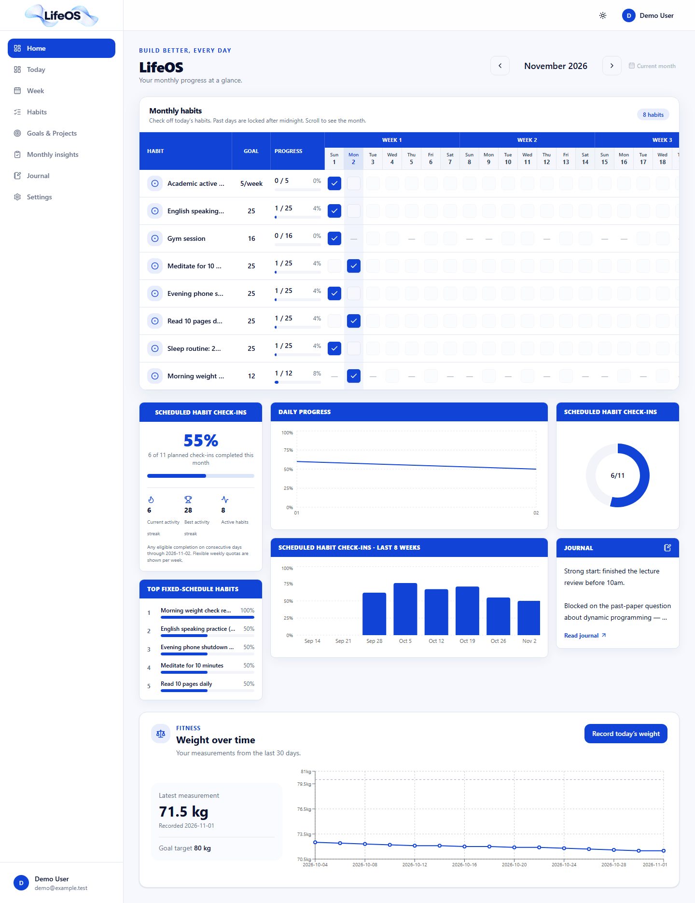
</p>

## In 30 seconds

I designed and built LifeOS end to end — product, data model, backend, UI, testing, CI/CD and packaging — as a single developer. It is a production web app (deployed on Vercel + Neon PostgreSQL) that also ships as a **Windows desktop app** and an **Android app**, both of which can run fully offline on an embedded database.

|                           |                                                                                                                                                                                                                |
| ------------------------- | -------------------------------------------------------------------------------------------------------------------------------------------------------------------------------------------------------------- |
| **What it does**          | Turns goals into weekly plans, daily priorities and habits, then reports what was really done — tasks finished, habit consistency, interview and English practice, internship applications, body-weight trend. |
| **My role**               | Sole developer: product design, UX, database design, server logic, security, testing, DevOps, desktop and Android packaging.                                                                                   |
| **Stack**                 | Next.js 16 (App Router, Server Actions) · React 19 · TypeScript · PostgreSQL · Drizzle ORM · Better Auth · Zod · Tailwind CSS 4 · Recharts · Vitest · Playwright · Electron · Android WebView · PGlite         |
| **Scale of the codebase** | ~21,500 lines of application TypeScript · 37 tables · 28 versioned migrations · 69 server actions · 211 commits                                                                                                |
| **Quality bar**           | 30 unit-test files, 11 database integration suites (PostgreSQL **and** PGlite), 20 Playwright browser specs, all gated in GitHub Actions on every push                                                         |
| **Measured impact**       | A real-data performance fix cut the Week page from **6.46 MB to 0.79 MB** of HTML and Today's mounted forms from **1,038 to 23** ([report](docs/POPULATED_ACCOUNT_PERFORMANCE.md))                             |

## The problem it solves

Most productivity tools keep goals, calendars, habit trackers and journals in separate places, so it is hard to tell whether daily effort is actually moving a long-term goal. LifeOS links them in one loop, and every screen feeds the next:

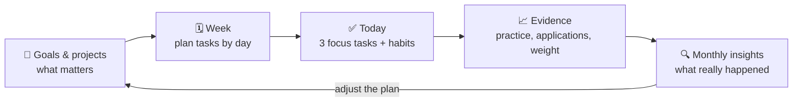

The design principle throughout: **record what happened, never guess.** Analytics are calculated from saved entries only, past days lock at midnight in the user's own timezone, and editing a recurring schedule never rewrites history.

## Product tour

All screenshots come from a real production build running locally with a demo account and sample data — no mock-ups.

### Today — a focused daily plan

Pick up to three ranked focus tasks, switch to a lighter "show less today" mode on hard days, and check off the habits scheduled for today.

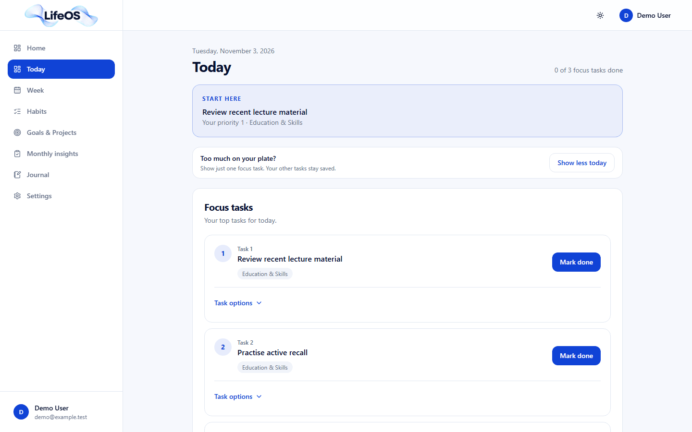

### Week — plan without time-slot micromanagement

Each task gets a day, not a rigid time slot. Recurring and one-off tasks, completion counts per day and quick "change day" moves.

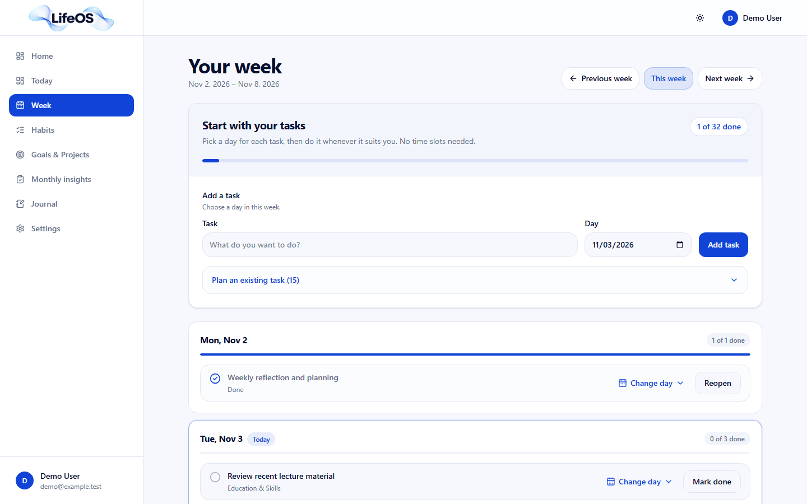

### Goals & projects — connect daily work to outcomes

Tasks are grouped by life area and linked to goals and projects, so finishing a task visibly advances a goal.

| Tasks by area                                                                | Projects and milestones                                             |
| ---------------------------------------------------------------------------- | ------------------------------------------------------------------- |
| 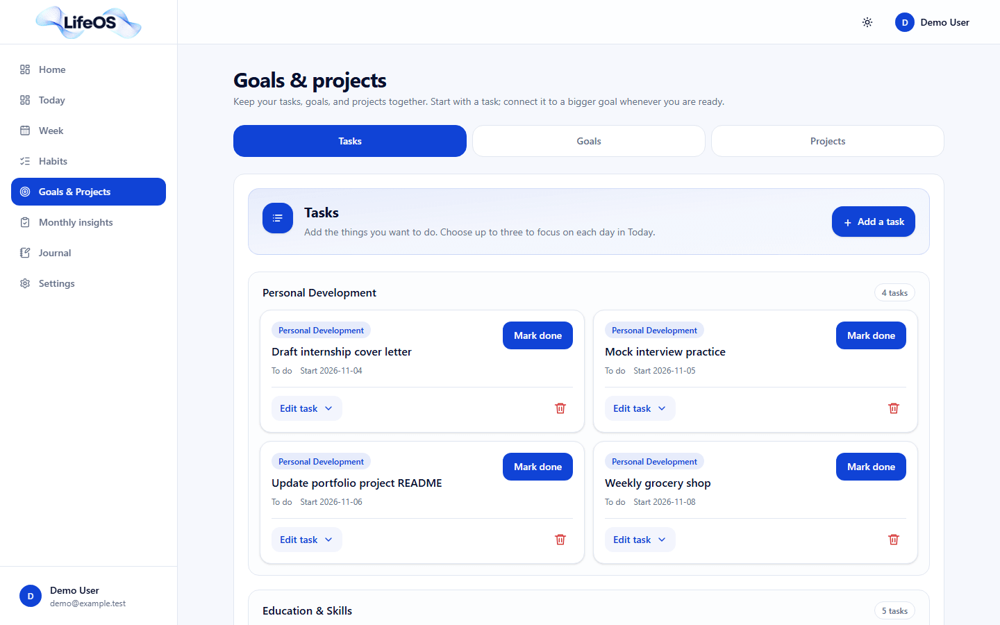 | 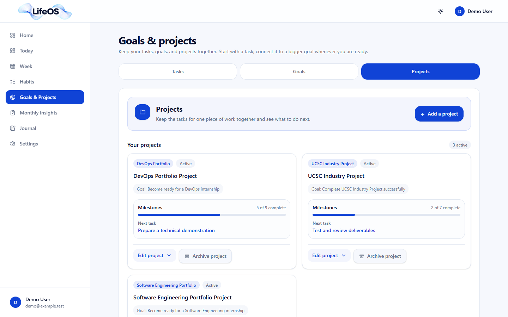 |

### Evidence & career readiness — proof of progress, not just to-dos

Log interview practice and English speaking sessions with self-ratings, and run an internship application pipeline where every stage change is recorded in history.

| Interview & English practice                                                                             | Internship application pipeline                                                                           |
| -------------------------------------------------------------------------------------------------------- | --------------------------------------------------------------------------------------------------------- |
| 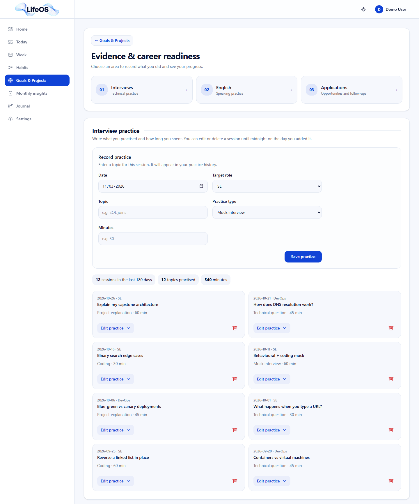 | 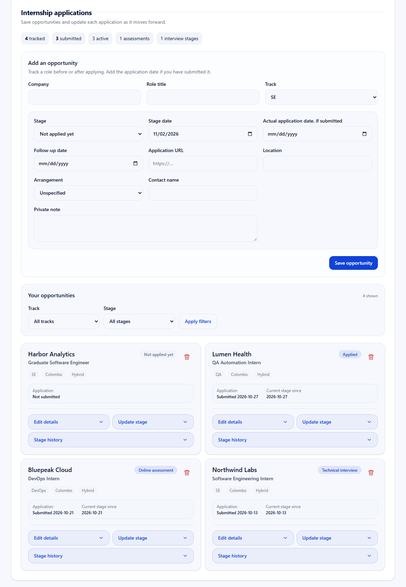 |

### Habits and the monthly tracker

Fixed-day habits ("Tue, Wed, Fri, Sat") and flexible weekly quotas ("5 times per week") with correct, schedule-aware progress maths, streaks, charts and a weight trend.


<details>
<summary><b>Habit list</b></summary>
<br>
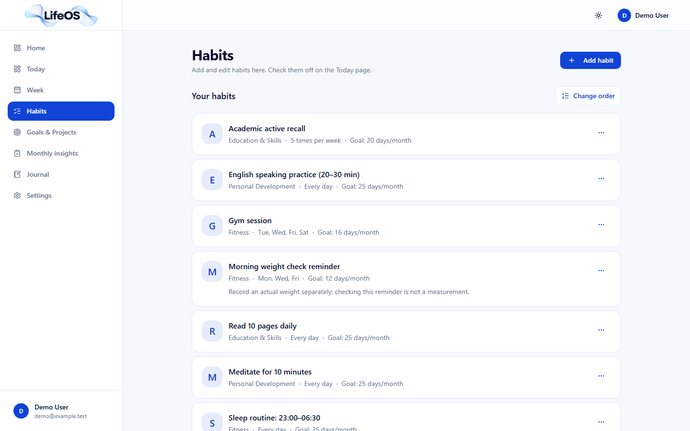
</details>

### Monthly insights — notice, learn, adjust

A 30-day review that compares tasks finished, habit consistency, evidence by period, goals in motion and recorded outcomes — then suggests one concrete next step.

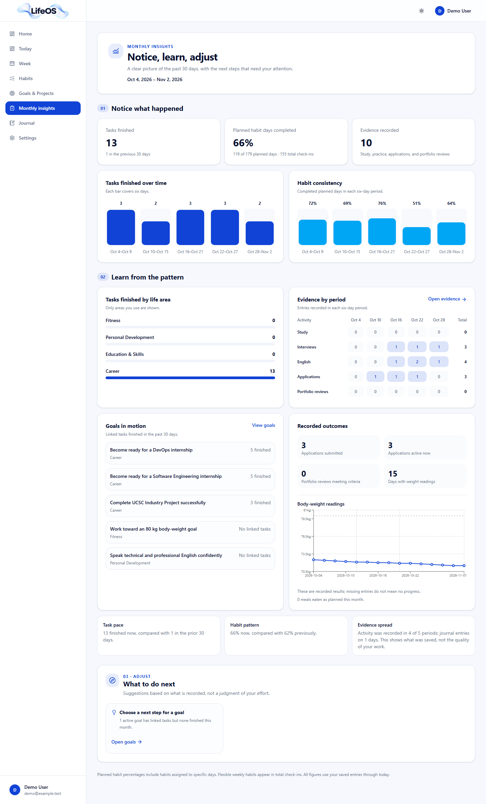

### Guided setup and data ownership

A starter plan can be previewed before anything is written, then installed idempotently. Users can export a versioned JSON backup and restore or merge it later.

| Preview-before-install setup                                                                | Settings, export and restore                                                                   |
| ------------------------------------------------------------------------------------------- | ---------------------------------------------------------------------------------------------- |
| 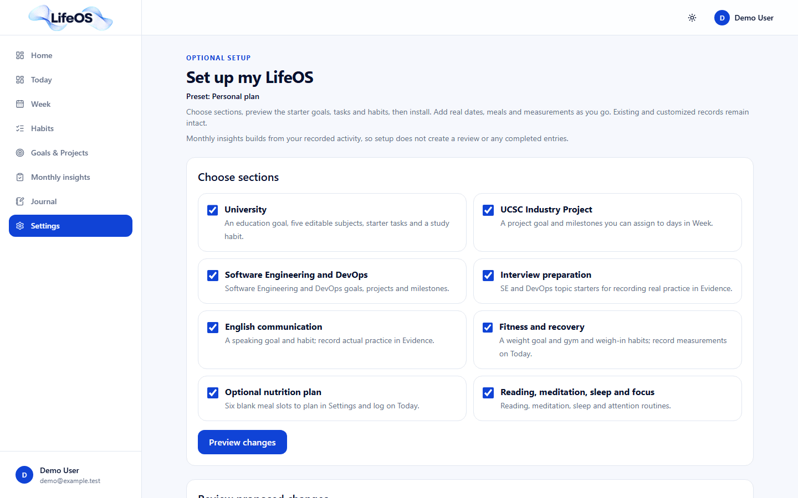 | 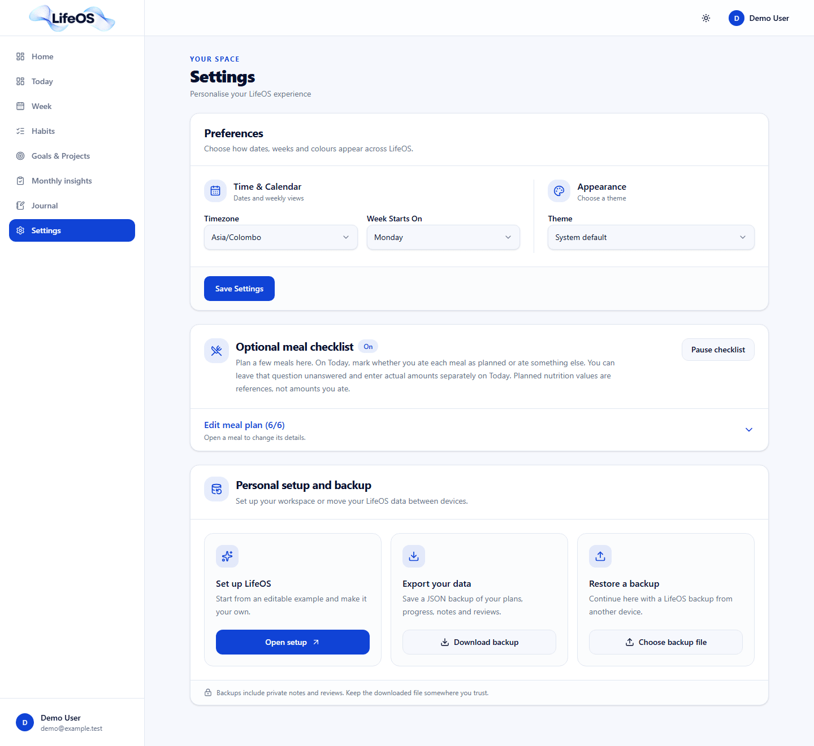 |

### Mobile

Fully responsive, and also packaged as an Android app.

<p>
  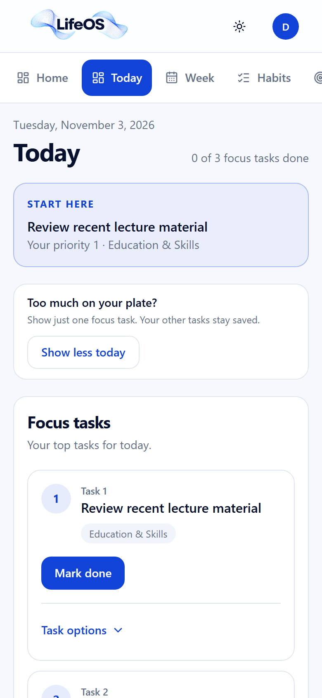
  &nbsp;&nbsp;
  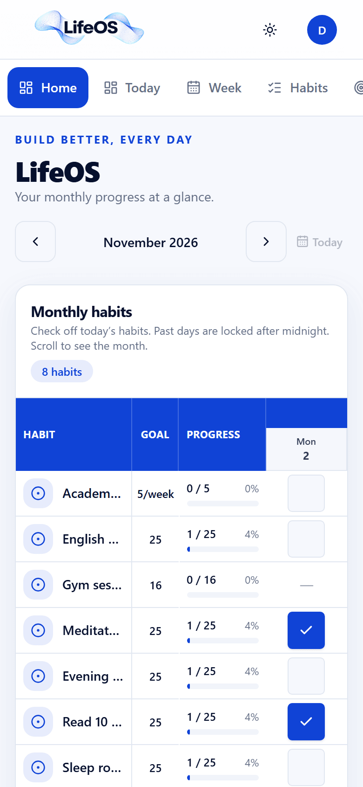
</p>

## Architecture

### System overview

One Next.js codebase serves three delivery targets. In the cloud it talks to PostgreSQL; on desktop and Android it can instead start an embedded PostgreSQL-compatible database (PGlite) so the app works completely offline.

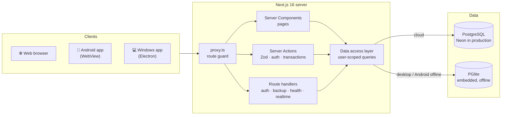

### How a write is protected

Every mutation goes through the same defensive path. This is the flow for adding a time block, which must never overlap a fixed commitment even when two tabs save at the same moment:

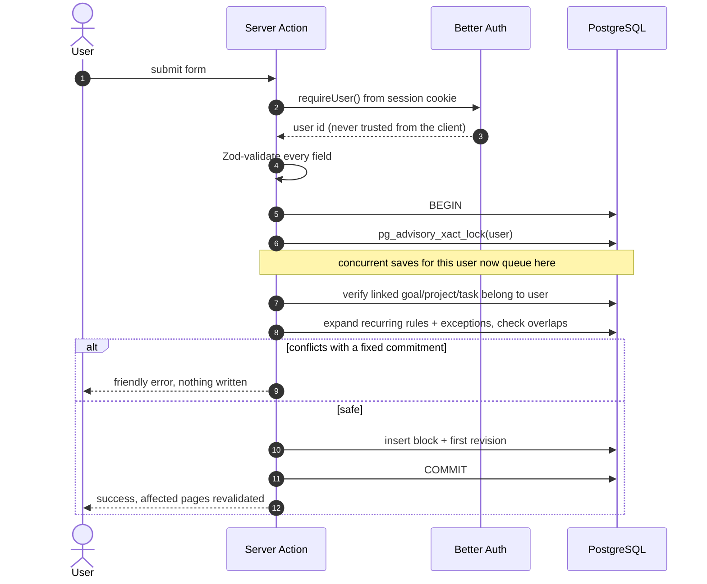

### Data model (core)

37 tables in total; this is the planning core. Ownership is enforced **in the database** with composite foreign keys on `(user_id, id)`, so a row can never reference another user's goal or project — even if application code had a bug.

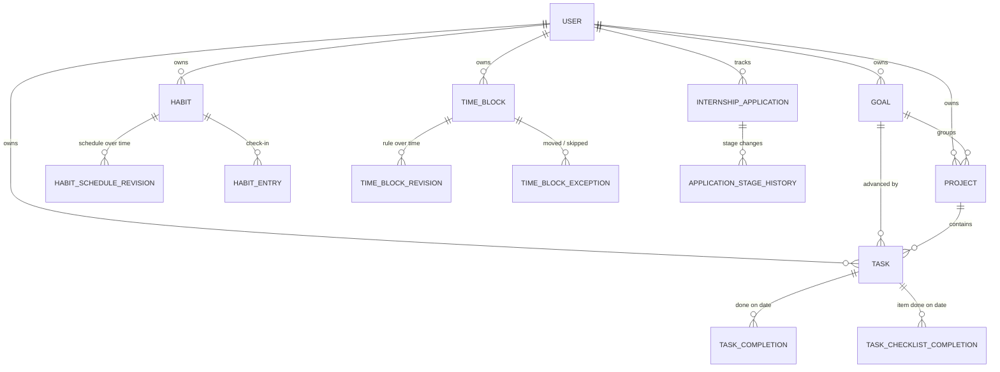

### Real-time sync for the Android app

Database triggers emit a `NOTIFY` for every user-owned row change. The server holds **one shared `LISTEN` connection per process** and fans events out to each user's open Server-Sent Events streams, so connected devices refresh within moments without each one holding a database connection.

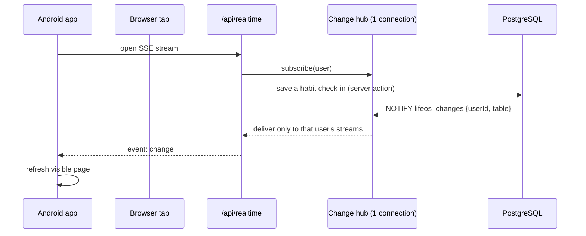

## Engineering highlights

These are the problems I found most interesting, and how the code solves them.

<details open>
<summary><b>1. Editing a recurring schedule without rewriting history</b></summary>

Changing "Gym: Mon/Wed/Fri" to "Tue/Thu" must not make last month's report claim you missed Tuesdays. Both habits and time blocks store **dated revisions**; for any date the app picks the latest rule effective on that date ([`ruleOn`](lib/planning/time-blocks.ts), [habit progress](lib/analytics/habit-month-progress.ts)). Moving or skipping a single occurrence is stored as an exception that keeps the original occurrence's identity, so completions stay attached to the right session.
</details>

<details>
<summary><b>2. Correctness under concurrency</b></summary>

Schedule writes take a per-user PostgreSQL **transaction-scoped advisory lock**, then re-check overlaps inside the transaction, so two tabs cannot both "win" the same slot. Daily priorities are reordered transactionally and backed by a **unique index** on `(user_id, scheduled_date, daily_priority)`, so the database itself rejects two tasks in one slot ([`life-actions.ts`](lib/actions/life-actions.ts)).
</details>

<details>
<summary><b>3. Security and data isolation by design</b></summary>

- The user id comes only from the server-side session — never from form data ([`session.ts`](lib/auth/session.ts)).
- Every query filters by owner, and composite foreign keys make cross-account references impossible at the database level.
- All input is validated with shared Zod schemas; redirects after login are restricted to known app paths to prevent open redirects ([`redirect.ts`](lib/auth/redirect.ts)).
- Backup restore requires a same-origin request and runs in one transaction — a failed import leaves existing data untouched.
- Production refuses to boot with an insecure configuration (non-HTTPS auth URL, local database, missing `sslmode=require`) ([`env.ts`](lib/env.ts)).

</details>

<details>
<summary><b>4. Time zones and daylight-saving time</b></summary>

"Today" is computed in each user's IANA time zone, and past days lock at _their_ midnight. Scheduled times are converted with explicit checks that **reject non-existent or ambiguous wall-clock times** during DST changes instead of silently guessing ([`occurrence-time.ts`](lib/planning/occurrence-time.ts)). A dedicated CI job runs the browser suite at a moment that crosses local midnight.
</details>

<details>
<summary><b>5. Finding and fixing a real performance bottleneck</b></summary>

Read-only diagnostics on a heavily used account found 23 tasks holding 1,015 checklist items, and the UI was rendering every item's form even when collapsed. I changed disclosures to mount content only when opened and measured the result on the same anonymised data:

| Measurement            |  Before |       After |
| ---------------------- | ------: | ----------: |
| Week page HTML         | 6.46 MB | **0.79 MB** |
| Today page HTML        | 1.71 MB | **0.28 MB** |
| Forms mounted on Today |   1,038 |      **23** |

An earlier optimisation pass brought Android Today navigation from 872 ms to 114 ms and enforced a 300 ms budget with an automated benchmark ([`PERFORMANCE.md`](docs/PERFORMANCE.md)).
</details>

<details>
<summary><b>6. One codebase, three platforms, offline-capable</b></summary>

The same Next.js build runs in the cloud, inside an **Electron** Windows installer, and inside an **Android** app. Without a cloud URL, the desktop and Android launchers start a bundled Node server with an embedded PGlite database, apply migrations on start-up, and keep data on the device. CI builds the Windows installer and verifies data survives a restart ([`DESKTOP.md`](DESKTOP.md), [`ANDROID.md`](ANDROID.md)).
</details>

<details>
<summary><b>7. Safe, repeatable onboarding</b></summary>

The starter plan shows a **read-only preview** of what will be created, then installs in a single transaction. Stable template keys and seed-item records mean running it again never duplicates items or resurrects ones the user deleted ([`install.ts`](lib/life-os/install.ts)).
</details>

<details>
<summary><b>8. Migrations that are tested against real old data</b></summary>

Every schema change is a reviewed Drizzle migration. Integration suites build databases at **older release versions**, fill them with data, upgrade them, and assert nothing was lost — on both PostgreSQL and PGlite ([`release-upgrade.mjs`](tests/integration/release-upgrade.mjs)).
</details>

## Quality and delivery

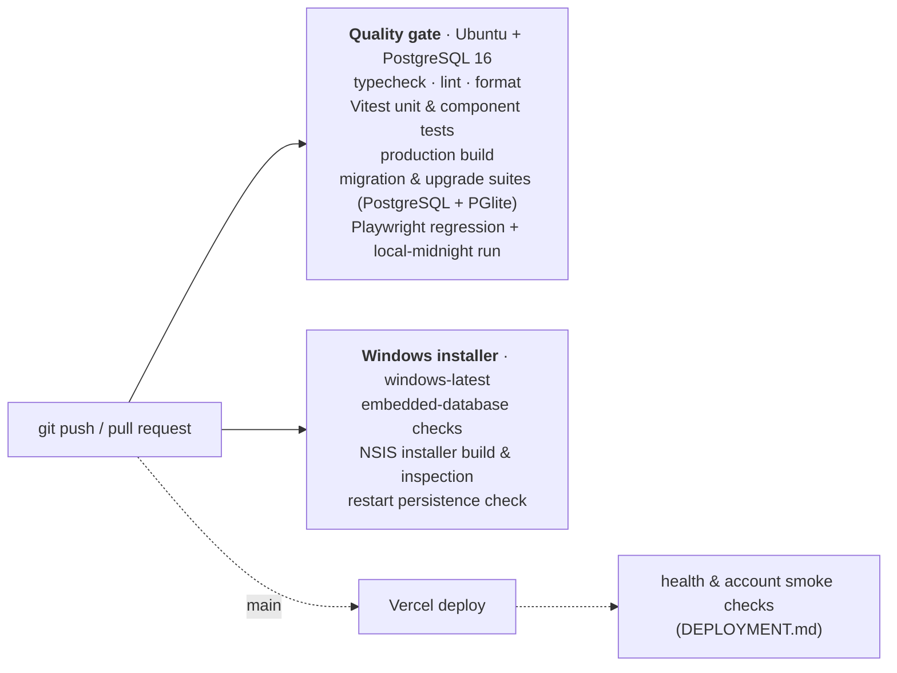

| Layer                                          | What is covered                                                                                                                                       |
| ---------------------------------------------- | ----------------------------------------------------------------------------------------------------------------------------------------------------- |
| **Unit & component** (Vitest, Testing Library) | scheduling rules, recurrence, analytics maths, priority ordering, backup import/export, auth validation, server actions against an in-memory database |
| **Integration** (Node + real databases)        | fresh migrations, upgrades from earlier releases, ownership constraints, concurrent rank operations, persistence after close/reopen                   |
| **Browser** (Playwright)                       | sign-up/sign-in and account isolation, Today/Week/Goals flows, habit lifecycle, evidence, responsive layouts at five widths, local-midnight boundary  |
| **Packaging**                                  | desktop and Android server smoke tests, Windows installer inspection, restart persistence                                                             |

## Tech stack

| Area      | Technologies                                                                                                                |
| --------- | --------------------------------------------------------------------------------------------------------------------------- |
| Frontend  | Next.js 16 App Router, React 19 Server & Client Components, TypeScript, Tailwind CSS 4, Radix UI, Recharts, React Hook Form |
| Backend   | Next.js Server Actions & Route Handlers, Better Auth (database sessions), Zod                                               |
| Data      | PostgreSQL (Neon), Drizzle ORM & migrations, PGlite (embedded), LISTEN/NOTIFY + Server-Sent Events                          |
| Testing   | Vitest, Testing Library, Playwright, database integration scripts                                                           |
| DevOps    | GitHub Actions, Vercel, Docker Compose for local PostgreSQL                                                                 |
| Platforms | Web, Windows (Electron + NSIS installer), Android (WebView + bundled Node runtime)                                          |

## Run locally

Requires Node.js 24 and npm. The quickest path needs **no Docker**: an embedded database.

```bash
git clone https://github.com/gayashan-indrasankha/LifeOS.git
cd LifeOS
npm ci
cp .env.example .env.local   # then set BETTER_AUTH_SECRET to 32+ random characters
```

```bash
npm run db:embedded   # terminal 1: embedded database, applies migrations
```

```bash
npm run dev           # terminal 2: http://localhost:3000
```

Prefer real PostgreSQL? Run `docker compose up -d postgres` and `npm run db:migrate` instead of `db:embedded`. On Windows PowerShell use `Copy-Item .env.example .env.local`.

Quality checks:

```bash
npm run typecheck && npm run lint && npm test && npm run build
```

More detail: [deployment](DEPLOYMENT.md) · [desktop](DESKTOP.md) · [Android](ANDROID.md) · [cloud migration](CLOUD.md) · [scheduling rules](SCHEDULING.md) · [release checklist](docs/RELEASE_CHECKLIST.md)

## Repository map

```text
app/                 Routes, layouts and API endpoints (App Router)
components/          Feature UI and shared controls
lib/actions/         Authenticated mutations and business rules
lib/dal/             User-scoped reads
lib/db/              Drizzle schema, connection and 28 migrations
lib/planning/        Recurrence, occurrences, priorities, workload
lib/analytics/       Habit progress, streaks and summaries
lib/realtime/        Shared LISTEN connection for live updates
lib/life-os/         Starter-plan preset and transactional installer
desktop/  android/   Electron and Android packaging + local runtime
tests/               Unit, integration, browser and desktop checks
```

## Honest limits

- Local desktop/Android data does not sync automatically with the cloud account; moving data is an explicit export → import.
- The Android package targets ARM64 devices.
- There is no shared public demo account — create a free account on the [live app](https://lifeos-gayashan-2026.vercel.app) to try it with your own private data.

## About me

I'm **Gayashan Indrasankha**, a software engineer who enjoys owning a product from the first schema to the shipped installer. LifeOS is where I practise that end to end:

- **Product thinking** — a coherent loop from goals to review, with honest analytics that never invent progress.
- **Backend depth** — relational modelling, transactions, locking, migrations and database-enforced ownership.
- **Frontend craft** — accessible, responsive React Server Components with careful attention to performance.
- **Engineering discipline** — automated tests at every layer, CI gates, measured performance work and documentation.

I'm open to **software engineering and DevOps internship / graduate roles**. Let's connect on [GitHub](https://github.com/gayashan-indrasankha).
